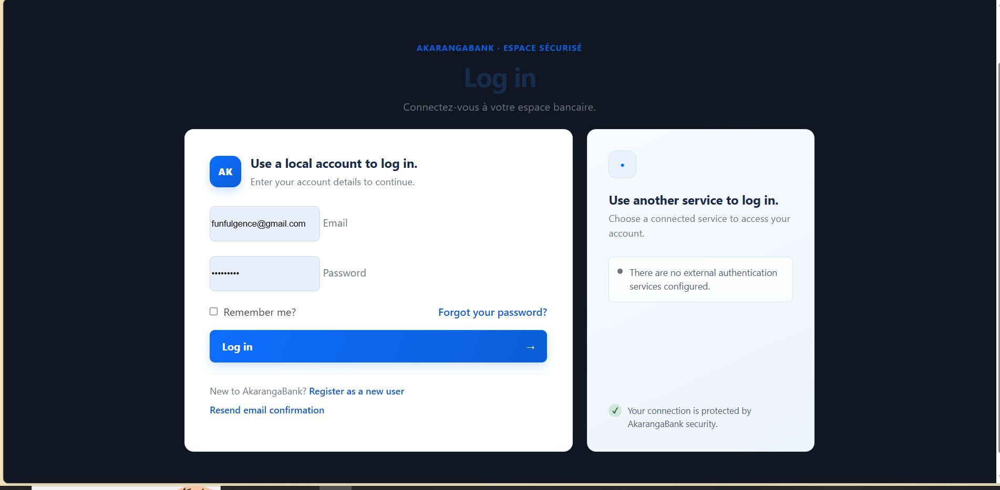
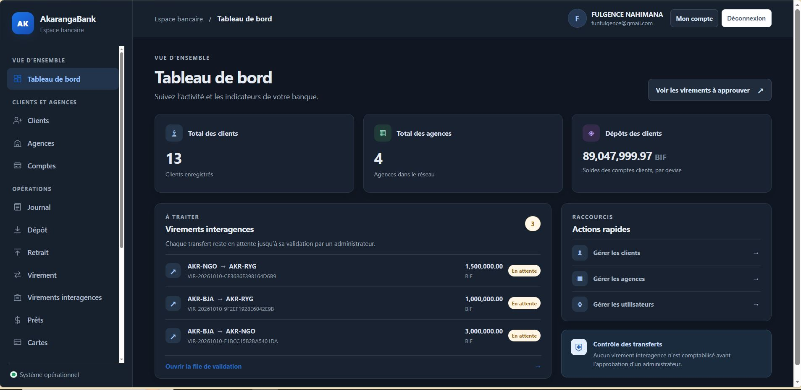
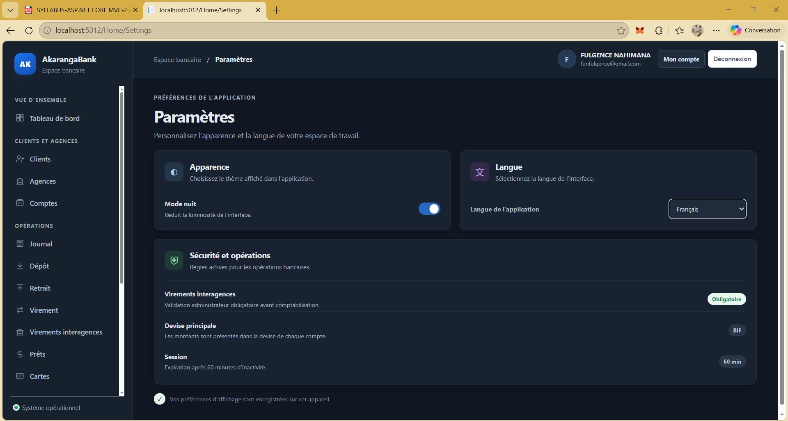

# Projet ASP.NET - UPG

Ce dépôt contient le projet pratique réalisé dans le cadre du cours d'ASP.NET enseigné à l'**Université Polytechnique de Gitega (UPG)**, au sein de la faculté **TIC**, département de **Génie Logiciel (Bac III)**.

## 👥 Auteurs
Ce projet a été conçu et développé en binôme par :
* **Nahimana Fulgence**
* **Niyorukundo Noella**

---

## 📌 À propos du projet
L'objectif principal de ce projet est de mettre en pratique les concepts fondamentaux et avancés du développement web avec le framework ASP.NET vus au cours. Il permet d'illustrer la maîtrise de la création d'applications web robustes, sécurisées et structurées selon les bonnes pratiques de l'architecture logicielle.

## 🛠️ Technologies utilisées
* **Langage :** C#
* **Framework :** ASP.NET (Core / MVC selon l'implémentation)
* **Base de données :** SQL Server (ou autre SGBD configuré)
* **Outils :** Visual Studio / .NET CLI

## 🚀 Fonctionnalités principales
* Gestion des utilisateurs / Authentification (le cas échéant)
* Opérations CRUD complètes (Création, Lecture, Mise à jour, Suppression)
* Interface utilisateur intuitive et responsive
* Connexion à la base de données via Entity Framework (ou approche similaire)

## ⚙️ Installation et exécution
Pour lancer ce projet en local, suivez les étapes ci-dessous :

1. Clonez ce dépôt sur votre machine :
   ```bash
   git clone https://github.com/Fufunahimana/akarangaBank.git
   ```
2. Ouvrez le projet dans **Visual Studio** ou votre éditeur de code favori.
3. Restaurez les packages NuGet et configurez la chaîne de connexion à votre base de données dans le fichier `appsettings.json`.
4. Exécutez les migrations de la base de données si nécessaire :
   ```bash
   dotnet ef database update
   ```
5. Lancez l'application en appuyant sur `F5` ou via la commande :
   ```bash
   dotnet run

Utilisez ces comptes pour tester les différents rôles :
| Rôle | Adresse e-mail | Mot de passe |
| --- | --- | --- |
| Administrateur (`admin`) | `testadmin@gmail.com` | `Pr123456@` |
| Gestionnaire (`gestionnaire`) | `testgestionnaire@gmail.com` | `Pr123456@` |
| Auditeur (`auditeur`) | `testauditeu@gmail.com` | `Pr123456@` |
| Guichetier (`guichetier`) | `testguichetier` | `Pr123456@` |
| Guichetier (`client`) | `client` | `Pr123456@` |```

---
*Université Polytechnique de Gitega (UPG) — Faculté TIC — Génie Logiciel Bac III (2025-2026)*







## Déploiement sur Railway

Ajoutez un service MariaDB ou MySQL au projet Railway. Les variables d'un service de base de données ne sont pas automatiquement disponibles dans le service web : il faut les référencer dans les variables du service web.

Dans **service web → Variables**, ajoutez `ConnectionStrings__AkarangaBank`. Pour un service MariaDB qui fournit `MARIADB_PRIVATE_URL`, utilisez cette valeur (remplacez `MariaDB` par le nom exact de votre service) :

```text
ConnectionStrings__AkarangaBank=${{MariaDB.MARIADB_PRIVATE_URL}}
```

Pour le service MySQL Railway, référencez `MYSQL_URL` à la place :

```text
ConnectionStrings__AkarangaBank=${{MySQL.MYSQL_URL}}
```

L'application accepte aussi les variables individuelles `MYSQL*` et `MARIADB_*`. Après l'ajout de la référence, appliquez les changements en attente et redéployez le service web. Vous pouvez aussi définir directement `ConnectionStrings__AkarangaBank` avec une chaîne de connexion MySqlConnector valide. Ne stockez pas les identifiants de la base dans les fichiers du dépôt.

### Erreur « Bad Request - Invalid Hostname »

Si le navigateur affiche cette erreur avec le domaine public Railway, la requête est rejetée par l'edge Railway avant d'arriver à ASP.NET Core. Vérifiez dans **service web → Settings → Networking** que le domaine `akarangabank-production.up.railway.app` est bien généré/attaché à ce service, et non à un autre service du projet. Le Dockerfile écoute sur le port `8080` : configurez le port cible public sur `8080` si Railway le demande. Appliquez les changements puis redéployez le service web. `AllowedHosts` inclut déjà ce domaine dans `appsettings.Production.json`; le changer ne corrige pas un domaine qui n'est pas rattaché au service côté Railway.
